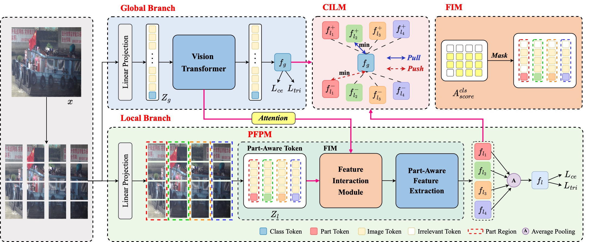
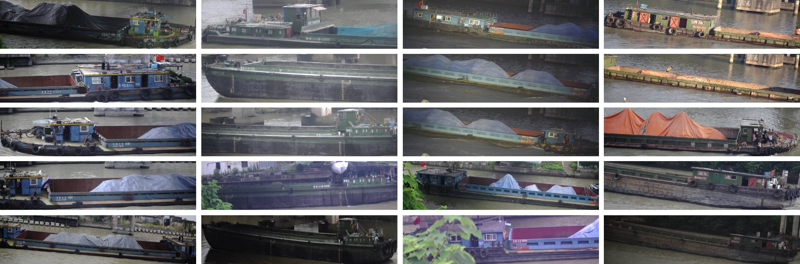

<div align="center">

# ShipReID-2400 & D2InterNet++

### Ship Re-Identification in the Wild: A Large-Scale Dataset and a Strong Baseline

[](#installation)
[](#installation)
[](https://pan.baidu.com/s/1E7yLizsIv0E8SVgn45IWpQ?pwd=kfbn)

[Overview](#overview) · [Dataset](#dataset) · [Installation](#installation) · [Training](#training) · [Evaluation](#evaluation) · [Results](#results) · [Citation](#citation)

</div>

Research code and dataset interface accompanying the manuscript **“Ship Re-Identification in the Wild: A Large-Scale Dataset and a Strong Baseline.”** This repository contains the implementation snapshot of the Feature-Decoupled Dual-Branch Interaction Network (**D2InterNet++**) for ship re-identification.

> **Release status:** this is a research snapshot. Generated per-image captions are not yet connected to the data loader, the validation/test loaders share a gallery, and standalone evaluation needs an update. See [reproducibility notes](docs/reproducibility.md) for details. The reported paper results have not been independently reproduced from this checkout.

## Overview

Ship re-identification matches the same vessel across cameras and time periods. Changes in scale, viewpoint, cargo, water level and partial visibility make this task challenging.

D2InterNet++ combines a **global visual branch** and a **local part-aware branch**, with a Part-Aware Feature Perception Module (PFPM), Feature Interaction Module (FIM), and Collaborative Interaction Learning Module (CILM). The implementation also includes a frozen CLIP text encoder for auxiliary image-text supervision during training.

<p align="center">
  
</p>

*Visual branch architecture supplied with the project. The auxiliary text branch is not shown in this figure.*

## Dataset

**ShipReID-2400** is a ship re-identification dataset collected from a real-world waterway monitoring system.

| Property | Reported value |
| :--- | :--- |
| Ship identities | 2,400 |
| Images | 17,241 |
| Cameras | 8 |
| Collection period | 53 months |

Image totals and query/gallery overlap require clarification; see [dataset split accounting](docs/reproducibility.md#dataset-split-accounting).

<p align="center">
  
</p>

### Download

| Dataset | Download | Extraction code / 提取码 |
| :--- | :--- | :---: |
| ShipReID-2400 | [Baidu Netdisk / 百度网盘](https://pan.baidu.com/s/1E7yLizsIv0E8SVgn45IWpQ?pwd=kfbn) | **`kfbn`** |

The dataset is distributed separately from the source code. Download and extract it under your dataset root. The loader expects the directory name **`ShipReID2400`**:

```text
<DATASETS.ROOT_DIR>/ShipReID2400/
├── bounding_box_train/
├── bounding_box_test/
├── val_query/
├── test_query/
├── bounding_box_train.jsonl
├── val_query.jsonl
├── val_gallery.jsonl
├── test_query.jsonl
└── test_gallery.jsonl
```

This tree describes the current loader's expected inputs. See [dataset and annotation format](docs/data-format.md) for filenames, JSONL structure and path matching requirements.

## Installation

The environment recorded by the project is **Python 3.8, PyTorch 1.9.1 and CUDA 11.1**. An NVIDIA CUDA device is required by the current code.

```bash
git clone https://github.com/923076046/ShipReID-2400-6257.git
cd ShipReID-2400-6257

conda create -n shipreid python=3.8
conda activate shipreid
pip install torch==1.9.1+cu111 torchvision==0.10.1+cu111 \
  -f https://download.pytorch.org/whl/torch_stable.html
pip install -r requirements.txt
```

The CLIP ViT-B/16 weights are downloaded automatically on first use. Task-specific trained checkpoints are not included in this repository.

## Training

Run commands from the repository root. Replace the dataset and output paths with absolute paths on your machine.

```bash
CUDA_VISIBLE_DEVICES=0 python train.py \
  --config_file configs/ship/vit_base.yml \
  DATASETS.ROOT_DIR /absolute/path/to/datasets \
  DATASETS.NAMES ShipReID2400 \
  OUTPUT_DIR outputs/d2internetpp \
  SOLVER.IMS_PER_BATCH 48 \
  SOLVER.MAX_EPOCHS 300 \
  MODEL.PART_H 16 \
  MODEL.PART_W 4 \
  MODEL.ID_LOSS_WEIGHT 0.5 \
  MODEL.TRIPLET_LOSS_WEIGHT 5.0 \
  MODEL.PART_ID_LOSS_WEIGHT 0.5 \
  MODEL.PART_TRIPLET_LOSS_WEIGHT 5.0 \
  MODEL.TOKEN_CONTRAST_LOSS_WEIGHT 10.0 \
  MODEL.PART_RATIO 0.6 \
  MODEL.TOP_K 1.0 \
  MODEL.TOKEN_CONTRAST_TYPE triplet \
  MODEL.NO_TOKEN_MARGIN False \
  MODEL.text 0.4 \
  SOLVER.TOKEN_MARGIN 0.3
```

This command follows the current code snapshot. It is not a verified reproduction recipe for the manuscript. See [configuration differences](docs/reproducibility.md#configuration-differences) before comparing results. Validation/test metrics and checkpoints are written according to `SOLVER.EVAL_PERIOD` and `SOLVER.CHECKPOINT_PERIOD`.

## Evaluation

**Current limitation:** the standalone inference loop needs a batch-format update before the following command can be used. See [reproducibility notes](docs/reproducibility.md).

The intended evaluation command is:

```bash
CUDA_VISIBLE_DEVICES=0 python test.py \
  --config_file configs/ship/vit_base.yml \
  DATASETS.ROOT_DIR /absolute/path/to/datasets \
  DATASETS.NAMES ShipReID2400 \
  OUTPUT_DIR outputs/d2internetpp_eval \
  MODEL.PART_H 16 \
  MODEL.PART_W 4 \
  TEST.WEIGHT /absolute/path/to/checkpoint.pth
```

Before using this command, update `processor.do_inference` to unpack the text-aware validation batches returned by `val_collate_fn`. The periodic evaluation path inside `do_train` already accepts this batch format.

Evaluation reports mean Average Precision (mAP) and CMC Rank-1/5/10 after removing gallery samples with the same identity and camera as each query.

## Results

These values are copied from the manuscript and have **not** been independently reproduced from this repository snapshot.

| Configuration | ShipReID-2400 mAP | Rank-1 |
|---|---:|---:|
| D2InterNet++ visual model | 44.0 | 51.0 |
| D2InterNet++ with generated-caption supervision | 44.9 | 52.4 |

## Repository structure

```text
├── config/                    # Default configuration definitions
├── configs/ship/              # ShipReID experiment configuration
├── datasets/                  # Dataset adapters, transforms and samplers
├── exp/                       # Legacy experiment shell scripts
├── fig/                       # Repository figures
├── loss/                      # Classification, metric and alignment losses
├── model/                     # D2InterNet++ and CLIP implementation
├── processor/                 # Training and inference loops
├── solver/                    # Optimizers and learning-rate schedulers
├── utils/ship_text.py         # JSONL loading and prompt serialization
├── train.py                   # Training entry point
└── test.py                    # Evaluation entry point
```

`model/make_model copy.py` is a legacy development copy and is not imported by the training entry point.

Additional documentation:

- [Dataset and text annotation format](docs/data-format.md)
- [Implementation status and reproducibility notes](docs/reproducibility.md)

## Citation

If you use ShipReID-2400 or this implementation in your research, please cite the associated manuscript. A complete BibTeX entry and paper link will be added when the final author list and publication metadata are available.

## Related projects

Relevant open-source implementations include [CLIP-ReID](https://github.com/Syliz517/CLIP-ReID), [TransReID](https://github.com/damo-cv/TransReID), and [CLIP](https://github.com/openai/CLIP).

## License

A project-wide software license and dataset terms have not yet been specified. This repository does not grant an additional license for third-party components; retain and follow any notices supplied with those components.
